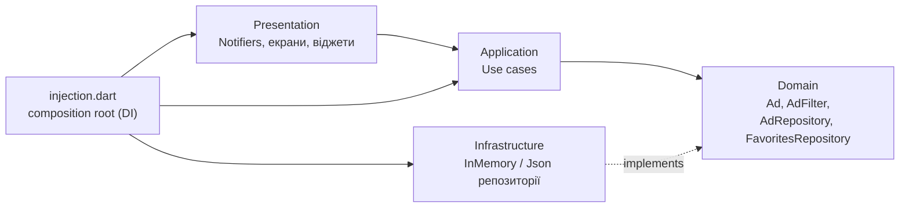

# Marketplace — ЛР №5 (варіант 13, маркетплейс оголошень)

Лабораторна робота №5 «Побудова архітектури застосунку. Робота з Git»
(дисципліна «Сучасні технології проєктування»).

Застосунок «Маркетплейс оголошень» з ЛР №3–4 (пошук, категорії, фільтр ціни, обране)
перебудовано за принципами **Clean Architecture**. Виконав: студент групи 4КІ1
Мунько Ілля Вадимович.

## Схема архітектури

Залежності спрямовані лише всередину: Presentation -> Application -> Domain.
Infrastructure залежить від Domain (реалізує його інтерфейси).



```text
              ┌────────────────────────────────────┐
              │ Presentation (Flutter, Provider)   │
              └──────────────────┬─────────────────┘
                                 │ викликає
              ┌──────────────────▼─────────────────┐
              │ Application (use cases)            │
              └──────────────────┬─────────────────┘
                                 │ залежить від абстракцій
              ┌──────────────────▼─────────────────┐
              │ Domain (сутності, інтерфейси)      │
              └──────────────────▲─────────────────┘
                                 │ реалізує
              ┌──────────────────┴─────────────────┐
              │ Infrastructure (репозиторії)       │
              └────────────────────────────────────┘
```

## Структура каталогів

```text
lib/
├── core/app_config.dart                       налаштування (спосіб зберігання, межа ціни)
├── domain/
│   ├── entities/ad.dart                       сутність «Оголошення»
│   ├── entities/ad_filter.dart                фільтр пошуку + правило matches()
│   └── repositories/                          інтерфейси AdRepository, FavoritesRepository
├── application/use_cases/                     SearchAds, GetCategories, Get/Toggle/ClearFavorites
├── infrastructure/repositories/               InMemoryAd/Favorites, JsonAd
├── presentation/
│   ├── providers/                             SearchNotifier, FavoritesNotifier
│   ├── screens/, widgets/, utils/, ad_visuals.dart, app.dart
├── injection.dart                             composition root: buildApp()
└── main.dart                                  точка входу
```

## Збірка і запуск

```bash
flutter pub get
flutter run -d chrome     # або: flutter run -d windows
flutter test              # unit-тести (use cases, репозиторії) та UI-тести
```

Змінити сховище даних можна в `lib/core/app_config.dart`: `storage = 'memory'` або `'json'`.
Use cases і UI при цьому не змінюються.

## Робота з Git

Політика гілок описана в [docs/BRANCHING.md](docs/BRANCHING.md):
`main` — стабільний код, `develop` — інтеграційна гілка, `feature/*` — гілки задач
(`domain-layer`, `application-layer`, `infrastructure-layer`, `presentation-layer`).
Повідомлення комітів — за Conventional Commits. Поточна версія: `v1.0.0`.
